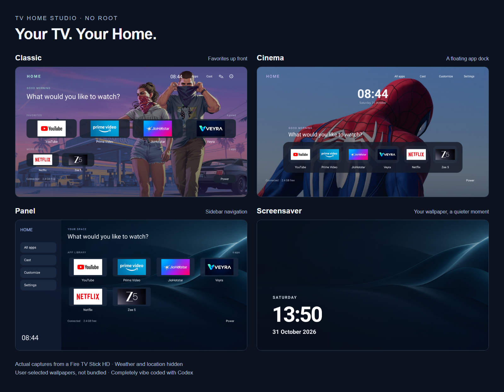

# TV Home Studio

**Your Fire TV. Three homes. No root.** A native TV launcher and Android phone companion for a quieter, more personal home screen.

> **Credits first:** built from [itsmeterrylin/fire-tv-cleanup](https://github.com/itsmeterrylin/fire-tv-cleanup), a fork of the original [Gathin23/cleanyourtv](https://github.com/Gathin23/cleanyourtv). The phone cleanup workflow was inspired by [udhaykumarbala/cleanyourtv-app](https://github.com/udhaykumarbala/cleanyourtv-app). Thank you to all three projects. This is an independent adaptation, not their official release. [Credits, provenance and licenses](docs/CREDITS.md).
>
> **Completely vibe coded with Codex**, iterated by testing on a real Fire TV Stick HD. Experimental community software; not an independently audited product.

[Download APKs](https://github.com/sreeego/tv-home-studio/releases/tag/v1.5.0) · [Install from your phone](docs/INSTALL.md#with-an-android-phone) · [Install from a computer](docs/INSTALL.md#with-a-computer) · [Build it yourself](docs/BUILD.md)

## Three designs, one launcher

| Classic | Cinema | Panel |
| --- | --- | --- |
| Familiar favorites and an app grid, mint accents and a quiet toolbar. | Centered bold clock, floating app dock and a gentle focus lift. | Sidebar navigation cards, a compact app grid and a clock at the bottom. |

Switch from **TV → Customize → Themes**, or explicitly apply a design in the phone app. Each design remembers its own wallpapers and visibility options. There is one launcher APK, not three separate installations.

[Classic full screenshot](docs/images/classic.png) · [Cinema full screenshot](docs/images/cinema.png) · [Panel full screenshot](docs/images/panel.png)

These are direct 1920 × 1080 captures from the maintainer's Fire TV, not mockups. Wallpapers and third-party app artwork shown belong to their owners and are **not bundled**. Installed apps such as Veyra shown in the captures are separate apps; this project does not distribute them or any IPTV playlists.

## What this version adds

This is the feature set of this adaptation, not a claim that upstream projects lack every feature listed here:

- Three distinct native layouts with TV-remote focus navigation; change themes on the TV or phone.
- Per-design wallpapers, optional rotation, element visibility, focus animation controls and reset-to-default options. Recommended wallpaper: **1920 × 1080, 16:9**; JPEG/PNG/WebP, up to eight per design. 4K imports are resized.
- A shared, editable Home name. Favorites, hidden apps, Cast, Settings, optional Inputs, Sleep and Restart. Device support and Fire OS permissions apply.
- Weather for a city **you select**, or Off. No automatic IP-location lookup.
- A phone app that installs the launcher, applies designs, uploads wallpapers, manages optional extras and saves restore points. No phone-remote clone.
- Reversible cleanup of explicitly chosen extras: disables packages, never uninstalls them or clears their data. Original states are recorded before changes.
- Best-effort update restrictions and a resume option in Studio. Protected updaters can refuse changes; this is **not** a guaranteed OTA block.
- A Python + ADB computer installer with explicit cleanup selection and restore support. No Python packages beyond the standard library.
- No accounts, ads or analytics in this project. Phone-to-TV control uses authorized ADB on your local network.

## About the Amazon Home flash

The problem that motivated this work was briefly seeing Amazon Home during launcher transitions. This version removes the **timed overlay-to-activity handoff** from our Home path. Version 4.5 also catches app-initiated Home requests (including Back from YouTube) and existing Home-task resumes. It keeps the rendered Home buffer ready while another app is open, transparent and unable to take input, instead of removing and rebuilding the window. Wake preparation and service repair are shared by all three themes.

That is an implementation change, **not a promise that Amazon Home can never appear**. Fire OS controls the system Home activity; startup, service termination, permission changes, Settings transitions and different firmware can still expose it. Amazon Home remains installed and enabled so Settings and recovery remain available. There is no root or firmware patch.

## Compatibility and current status

- Physically tested: **Fire TV Stick HD, AFTSS, Fire OS 7.7.1.7 / Android 9, `armeabi-v7a` (32-bit ARM)**. ARMv7 works on this device; both APKs contain no bundled native libraries and need no architecture-specific download.
- Launcher minimum: Android 8 / API 26 on Android-based Fire TV. Phone minimum: Android 9.
- Uses classic authorized ADB over TCP, usually port 5555. Newer firmware may restrict it. Vega OS and Android wireless-debugging TLS pairing are not supported.
- Other Android-based Fire TV models are unverified; integrated-TV Inputs, IR/power behavior and OEM restrictions vary.
- Fire OS 5/6 are below the minimum API level. Non-Fire Android TV / Google TV are outside this fork's installer support, even where upstream supports them.
- Current release: **Studio 1.5 + TV Home 4.5**. See the [compatibility matrix and limitations](docs/COMPATIBILITY.md) and [validation](docs/VALIDATION.md).

## Get started

1. Download **TV-Home-Studio-1.5.apk** for your Android phone, or **TV-Home-4.5.apk** for computer installation.
2. Follow [INSTALL.md](docs/INSTALL.md), then select **This home**.
3. Choose your design, add your own wallpapers, and review cleanup separately.

[Recovery and troubleshooting](docs/INSTALL.md#recovery) · [Privacy and permissions](docs/PRIVACY.md) · [Full guide](docs/GUIDE.md)

MIT for this project's code, retaining upstream notices. AdbLib code uses BSD 3-Clause; all bundled third-party notices are in [licenses/](licenses/) and [THIRD-PARTY-NOTICES.txt](THIRD-PARTY-NOTICES.txt). Wallpaper and app trademarks are not covered by the code license.
